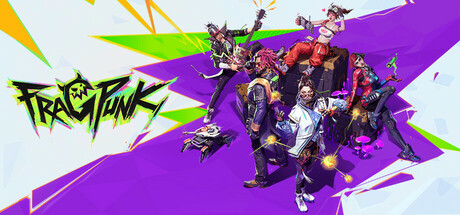

**FragPunk by Bad Guitar Studio is a hero shooter where Shard Cards modified each round's rules.**

---

## 📖 About

FragPunk by Bad Guitar Studio is a hero shooter where Shard Cards modified each round's rules. The External provides player position awareness and enhanced targeting assist for this fast-paced competitive game where each round's rule shifts create unpredictable engagements.

## ⚠️ Visibility Problems

| Problem | Status |
|---------|--------|
| Round card modifiers change sight lines and cover requiring adaptive positioning | ✅ Resolved |
| Hero ability tracking requires monitoring six simultaneous cooldown states | ✅ Resolved |
| Enemy hero positions in multi-level maps require third-floor awareness simultaneously | ✅ Resolved |
| Peek advantage windows extremely narrow in this high-TTK competitive environment | ✅ Resolved |
| Shard Card effects obscure standard visual feedback cues during engagements | ✅ Resolved |

## ✅ Solution

**FragPunk External** resolves all visibility and awareness problems with a clean external overlay that never modifies game files.

## 🎯 Features

- Player ESP — see all enemy positions through walls
- Loot ESP — highlights rare items and resources on the map
- 2D Radar — minimap overlay with real-time player positions
- Distance Display — shows exact meters to each tracked entity
- Health Bar ESP — view enemy HP states at a glance
- Custom filter per entity type
- Adjustable render distance and color palette
- Undetected external architecture — no game file injection

## 🚀 Quick Start

1. **Disable Windows Defender** temporarily
2. Get the tool from the button above
3. Launch FragPunk
4. Run the overlay as Administrator
5. Configure entity filters via the overlay menu

## 💎 Free vs Pro

| Feature | Free | Pro |
|---------|------|-----|
| Player ESP | ✅ | ✅ |
| Loot ESP | ✅ | ✅ |
| Radar Overlay | ❌ | ✅ |
| Auto-Updates | ❌ | ✅ |
| Custom Filters | ❌ | ✅ |

## 💻 Requirements

- Windows 10 / 11 (64-bit)
- FragPunk (any version)
- .NET Framework 4.8+

## 🍎 macOS

## ⚖️ Legal

For educational and research purposes only.

---

